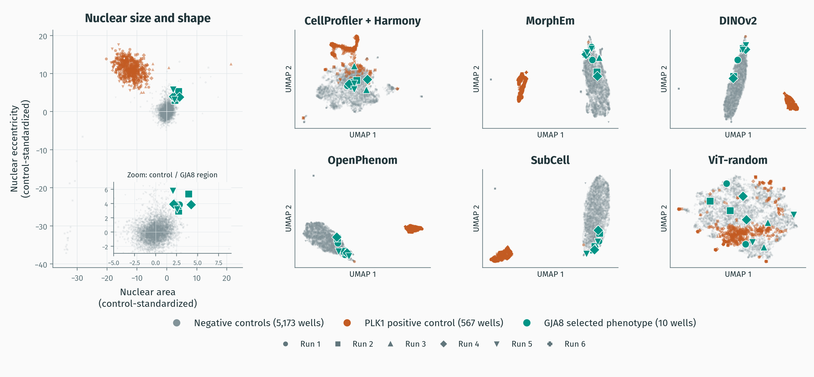

#+TITLE: Uncovering biological relationships through morphological profiling: The JUMP-Cell Painting dataset and tools
#+SUBTITLE:
#+AUTHOR: Alán F. Muñoz
#+DATE: 10 November 2026
#+STARTUP: beamer
#+OPTIONS: H:2 toc:nil num:nil author:t date:t ^:nil
#+LATEX_CLASS: beamer
#+LATEX_COMPILER: xelatex
#+LATEX_CLASS_OPTIONS: [aspectratio=169,10pt]
#+BEAMER_THEME: moloch
#+LATEX_HEADER: \usepackage{fontspec}
#+LATEX_HEADER: \usepackage{array}
#+LATEX_HEADER: \setsansfont{FiraSans-Regular.otf}[BoldFont=FiraSans-Bold.otf,ItalicFont=FiraSans-Italic.otf,BoldItalicFont=FiraSans-BoldItalic.otf]
#+LATEX_HEADER: \AtBeginDocument{\AtBeginSection[]{}}
#+LATEX_HEADER: \institute{Carpenter-Shen Lab, Purdue University; Carpenter-Singh Lab, Broad Institute}
#+PROPERTY: header-args :eval never-export

# Talk date: 10 November 2026. Venue, title revisions and duration not yet specified.
# Adapted from the FASEB deck at abdd682d172d44a7f3b5d514328dd37bc8b4bfab.
# Biologist audience; live coding-agent JUMP query replaces the scheduled recording.
# Aim for a 5–7 minute demo; total duration and the old FASEB timing require rehearsal.
# Current demo instructions: demo/README.md. docs/presenter-notes.md is historical.
# Keep slides direct and question-led. Interpretation limits belong in notes.
# References and QR close the main talk; additional slides follow for questions. Illustration provenance stays in the evidence documents.
# Direct Overleaf edits take content priority: preserve and port them into Org.
# This independent deck has no automatic synchronizer. Keep slides.org and slides.tex aligned.
# Fetch and preserve direct Overleaf edits before regenerating TeX.

* Conference draft
** What is Cell Painting?
#+BEGIN_EXPORT latex
\begin{columns}[c,onlytextwidth]
\begin{column}{0.36\textwidth}
\begin{itemize}
\item Fluorescence microscopy of cell morphology.
\item Six dyes, five imaging channels.
\item Shape, intensity and texture reveal cellular responses.
\end{itemize}
\end{column}
\begin{column}{0.60\textwidth}
\centering
\includegraphics[width=0.98\linewidth,height=0.85\textheight,keepaspectratio]{assets/cell-painting-channels.png}
\end{column}
\end{columns}
#+END_EXPORT

#+BEGIN_EXPORT latex
\par\smallskip\hfill{\fontsize{5.5}{6.5}\selectfont\color{gray}\href{https://github.com/afermg/2024_10_i2k_poster_flashtalk/blob/bf1db9f818dcc2704bd5ad388c3173a3426f8faf/figs/cellpainting.png}{Source: Muñoz, I2K (2024); assay: Bray et al. (2016)}}
#+END_EXPORT

# Speaker note: The five-channel-plus-merged panel from the I2K poster remains unchanged, including labels and scale bar.

** Cell Painting turns images into measurements
Profiles are numerical descriptions of cells.

#+ATTR_LATEX: :width 0.99\linewidth :height 0.66\textheight :options keepaspectratio
[[file:assets/cell-painting-edited.pdf]]

#+BEGIN_EXPORT latex
\par\smallskip\hfill{\fontsize{5.5}{6.5}\selectfont\color{gray}\href{https://doi.org/10.1038/s41573-020-00117-w}{Adapted from Chandrasekaran et al. (2021), Fig. 1a}}
#+END_EXPORT

# Speaker note: Narrate stain → image → measure → compare; the figure carries the on-screen explanation.
# Speaker note: At the presenter's request, restore the exact Mac-edited workflow PDF from before the color-consistency edits. Its earlier palette and cell drawings are unchanged; no new shape or color edits were made.
# Colors and shapes are illustrative, not measured phenotypes or validated health labels. Original source and Mac-edit hashes remain in docs/assets.json; the superseded color-consistent derivative is retained separately.
# Similarity helps prioritize biological hypotheses; it does not establish mechanism.

** JUMP: Joint Undertaking for Morphological Profiling
#+BEGIN_EXPORT latex
\begin{itemize}
\item Public Cell Painting data: 12 laboratories, around 136,000 perturbations.
\item \href{https://github.com/broadinstitute/jump-profiling-recipe/tree/d2512d978ca17aafead0e99de66386337e6312e4/inputs/cell_counts}{1.8 billion cells}; \textasciitilde{}58.3 million images.
\end{itemize}
\begin{center}
\fbox{\parbox[c][29mm][c]{0.27\linewidth}{\centering CRISPR knockout\par\medskip{\Large\bfseries 7,975}\par gene targets}}
\quad
\fbox{\parbox[c][29mm][c]{0.27\linewidth}{\centering\small Gene overexpression (ORF)\par\smallskip{\Large\bfseries 12,609}\par genes}}
\quad
\fbox{\parbox[c][29mm][c]{0.27\linewidth}{\centering Compound treatment\par\medskip{\Large\bfseries 115,794}\par compounds}}
\end{center}
#+END_EXPORT

# The presenter removed the visible audience-question bullet in Overleaf.

# Speaker note: ORF means open reading frame. JUMP used lentiviral ORF delivery, a 48-hour readout and no blasticidin selection in imaging wells; do not label this transient expression merely because the assay is short-term.
# The introduced coding sequence supports extra protein production; it does not activate the endogenous promoter, guarantee protein activity or ensure uniform expression in every cell.
# Source: Chandrasekaran et al. (2025), doi:10.1038/s41592-025-02753-9, Methods: Time point and ORF experiments. Researchers can reuse images, measurements and metadata.

# Speaker note: Counts use consortium metadata revision 016e865fa0691244e0860943e41c7d6a88ed2580, not JUMP-lite.
# Count distinct JCP2022 IDs present in wells, excluding negative-control and empty IDs; retain positive controls.
# Construct-level total: 138,897 perturbation IDs. ORF: 15,128 constructs, 12,598 nonmissing annotated gene/locus IDs, rounded on the slide.
# The presenter changed the visible headline to nearly 136,000. The displayed gene-level counting gives 115,794 compounds + 7,975 CRISPR targets + 12,598 ORF gene/locus IDs = 136,367 modality-specific entries, approximately 136,000.
# This is not 136,367 unique genes or distinct JCP2022 reagent IDs, nor a cross-modality deduplication; 138,897 remains the construct-level metadata total. Both definitions are retained rather than changing the verified input metadata.
# Definitions and input hashes are in docs/jump-perturbation-counts.json.
# Image count: 58,267,491 TIFF files summed across the 12 rows of stats/cpg0016_source_images_tiff_count.csv at the same pinned dataset revision; rounded to 58.3 million.
# This is the published cpg0016 image-archive count (including controls), not cells or five-channel sites. Do not divide by five to claim a field count: the published site-count total does not reconcile with the TIFF total through a five-channel factor; accounting/coverage was not reconciled here.
# Exact source URLs, input hashes and sums are in docs/jump-image-counts.json.
# Cell count: 1,810,840,525 across the pinned compound,ORF and CRISPR cell-count inputs at jump-profiling-recipe d2512d978ca17aafead0e99de66386337e6312e4; displayed as 1.8 billion at the presenter's request.
# Includes source_7; excludes the pilot datasets and source_15,which has no counts in those inputs. This counts cells across represented wells,not distinct perturbations,images or cells retained in a filtered profile release. Existing count verification is documented in JUMP Hub;no new segmentation or independent recount was performed for this slide. See docs/jump-cell-count-20261020.md.
# The principal dataset spans 12 data-generating centers. Its 13 Metadata_Source IDs include source_7 and source_13 from the same center.
# Verified in JUMP Hub data_description.md and terra_workspace.md at e742f5aa37472eb17f326ba8315d22b27e58f330; not every lab acquired every modality or perturbation.
# The audience question is no longer a visible bullet, preserving the latest author edit.

** How do we ensure improvements in computational models/methods benefit experimental biologists? :noexport:
#+BEGIN_EXPORT latex
\begin{columns}[T,onlytextwidth]
\begin{column}{0.48\textwidth}
\begin{block}{Methods development (ML)}
Does the model match known biology? Can we find new connections from looking at the whole picture?
\end{block}
\end{column}
\begin{column}{0.48\textwidth}
\begin{block}{Experimental biology}
Can I use this data/these models to answer my biological questions? To design follow-up experiments?
\end{block}
\end{column}
\end{columns}
#+END_EXPORT

# Speaker note: We invest heavily in comparing models, but less in making those advances usable by experimental biologists.
# Frame this as the motivation for the talk, not a measured claim about every ML researcher. Benchmarks remain necessary for testing methods.
# JUMP Hub and the notebook demo address practical access. JUMP-lite supports method development; neither replaces experimental validation.

** We make JUMP accessible via the JUMP Hub

#+BEGIN_EXPORT latex
\begin{columns}[c,onlytextwidth]
\begin{column}{0.60\textwidth}
\centering
\includegraphics[width=0.98\linewidth,height=0.71\textheight,keepaspectratio]{assets/jump-hub-homepage.png}
\end{column}
\begin{column}{0.37\textwidth}
\textbf{Biologists can find out:}\par\smallskip
\begin{itemize}
\item Does my gene or compound have a phenotype?
\item Which perturbations cause similar phenotypes?
\item What changes in cells and organelles?
\item Is the phenotype heterogeneous across cells/samples?
\end{itemize}
\end{column}
\end{columns}
#+END_EXPORT

#+BEGIN_EXPORT latex
\par\smallskip\hfill{\fontsize{5.5}{6.5}\selectfont\color{gray}\href{https://broadinstitute.github.io/jump_hub/}{Source: JUMP Hub (2026)}}
#+END_EXPORT

# Speaker note: Complementary to the researcher's other methods, such as transcriptomics, as clarified in the presenter's reply to Anne.
# These are alternative entry points, not compulsory steps. Cell-subpopulation exploration is the separate notebook example.
# Availability is not phenotypic activity: use the perturbation-level corrected p-value to assess a detectable profile.
# Homepage recaptured 21 October 2026 at native 3x browser pixel density; only the same Choose Your Own Path section is shown. Other interface screenshots are historical examples.

** Tutorials, how-tos and resources
The Hub contains practical guides to help biologists use JUMP.

#+BEGIN_EXPORT latex
\medskip
\begin{tabular}{@{}>{\raggedright\arraybackslash}p{0.27\textwidth}>{\raggedright\arraybackslash}p{0.68\textwidth}@{}}
\textbf{How-to guides} & \href{https://broadinstitute.github.io/jump_hub/howto/interactive/1_jumprr_steps.html}{No-code gene/compound queries}; \href{https://broadinstitute.github.io/jump_hub/howto/interactive/0_overview.html\#morpheus}{explore similarity heatmaps}. \\[1em]
\textbf{Tutorials} & \href{https://broadinstitute.github.io/jump_hub/howto/notebooks/0_overview.html}{Curated runnable notebooks for profiles, metadata and statistical analysis.} \\[1em]
\textbf{Further resources} & \href{https://broadinstitute.github.io/jump_hub/explanations/data_description.html}{Dataset explanations}, \href{https://broadinstitute.github.io/jump_hub/howto/notebooks/17_mislocus_example.html}{protein-localisation analysis} and a \href{https://ciminilab.github.io/GuideToCellPainting/}{Guide to Cell Painting for Biologists}.
\end{tabular}\par\bigskip
#+END_EXPORT

# Speaker note: Give a 30-second overview, borrowed from the Hub introduction (75 to45seconds). Explicitly say we added tutorials/how-tos, and the Hub links to useful resources beyond the examples covered in this talk. These are alternative starting points, not compulsory steps.
# The six notebook topics are retrieve profiles, add metadata, calculate activity, display perturbation images, explore distance clusters and query genes externally. Notebook overview links offer Colab, Terra or local Python with documented dependencies.
# No-code guides include availability queries, JUMP_rr and Morpheus heatmaps. Dataset explanations describe experimental context. The Guide to Cell Painting for Biologists is an external Cimini Lab resource linked by the Hub, not a guide newly authored by us.
# The MisLocus how-to is a separate VarChAMP companion workflow, not a JUMP assay or one of the Colab notebooks. Do not promise it runs in Colab.

** First, an extreme example: nocodazole
#+BEGIN_EXPORT latex
\begin{columns}[c,onlytextwidth]
\begin{column}{0.48\textwidth}
\centering\textbf{DMSO control}\par\smallskip
\includegraphics[width=0.88\linewidth,height=0.60\textheight,keepaspectratio]{assets/dmso-source2-A02-site1.jpg}
\end{column}
\begin{column}{0.48\textwidth}
\centering\textbf{Nocodazole}\par\smallskip
\includegraphics[width=0.88\linewidth,height=0.60\textheight,keepaspectratio]{assets/nocodazole-source2-P15-site1.jpg}
\end{column}
\end{columns}
\medskip
{\small An obvious change in this field pair. Could cell density dominate the profile?}
\par\smallskip
{\scriptsize Same source and plate; one illustrative field pair, not a direct assay of microtubules.}
#+END_EXPORT

# Nocodazole is now the opening extreme reference, not the main investigation.
# Unchanged source_2/1086292020 previews, DMSO A02 and nocodazole P15, site 1; see demo/rehearsal-nocodazole/image-provenance.json.
# The sparse treated field does not prove toxicity or mitotic arrest; CP does not directly stain tubulin.
# Original nocodazole activity/match extracts remain in demo/rehearsal-nocodazole/; they are not blebbistatin evidence.

** Next: blebbistatin, a known biological effect
#+BEGIN_EXPORT latex
\begin{block}{A more focused question}
Can we see evidence consistent with altered contractility or cytokinesis?
\end{block}
\begin{itemize}
\item Blebbistatin inhibits myosin II; it can impair contractility and cell division.
\item JUMP reagent: \texttt{JCP2022\_052617}, annotated blebbistatin-(+/-).
\item Inspect cell shape, nuclear organization and matched controls.
\item Use CellProfiler-derived profiles; distinguish prior biology from observations.
\end{itemize}
\par\smallskip\hfill{\fontsize{5.5}{6.5}\selectfont\color{gray}\href{https://doi.org/10.1126/science.1081412}{Straight et al., Science (2003)}; \href{https://broad.io/compound}{JUMP\_rr}; Repurposing annotations}
#+END_EXPORT

# Known biological action: Straight et al. (2003), DOI 10.1126/science.1081412. Expected cytokinesis changes are prior biology, not inferred from our preview.
# JUMP uses the racemate blebbistatin-(+/-), JCP2022_052617 / LZAXPYOBKSJSEX-UHFFFAOYSA-N; do not describe it as enantiopure active reagent.
# Saved summaries and input hashes: demo/rehearsal-blebbistatin/. A lower activity score does not establish lower toxicity, stronger specificity or reproducibility.

** Which compounds look similar to blebbistatin?
#+BEGIN_EXPORT latex
\textbf{Query: ``Show the closest published matches and resolve their annotations.''}\par\medskip
\begin{tabular}{@{}l r@{}}
\textbf{Returned match} & \textbf{Similarity} \\[5pt]
PF-04418948 & 0.737 \\
\texttt{JCP2022\_018073} & 0.732 \\
\texttt{JCP2022\_034452} & 0.731
\end{tabular}
\medskip
\begin{itemize}
\item These are profile matches, not verified myosin-II inhibitors.
\item Missing names or annotations need resolution, not a biological label.
\item Do the matches share a phenotype, or a confounding change?
\end{itemize}
{\footnotesize Published ranked subset; the saved annotation snapshot is incomplete.}
\par\smallskip\hfill{\fontsize{5.5}{6.5}\selectfont\color{gray}\href{https://broad.io/compound}{JUMP\_rr compound matches}; checked 9 November 2026}
#+END_EXPORT

# Existing published scores, not recomputed: demo/rehearsal-blebbistatin/matches.csv.
# The top match is JCP2022_052140 / PF-04418948, annotated prostaglandin inhibitor in the snapshot, not established as a myosin-II peer.
# Two next IDs lack names/MOA in that snapshot; absence of annotations is not proof of unrelated biology.
# Resolve identities/annotations and examine confounding before mechanistic interpretation. No exhaustive enrichment analysis was run.

** Does blebbistatin change cell morphology?
#+BEGIN_EXPORT latex
\begin{block}{Published activity result}
Corrected activity p-value: \textbf{0.01278}
\end{block}
\begin{itemize}
\item A detectable profile at a 0.05 threshold in this analysis.
\item Higher nuclear DNA-channel median intensity: Cohen's $d=2.241$.
\item Intensity alone does not establish DNA content or failed cytokinesis.
\end{itemize}
\medskip
\textbf{Follow-up question:} do images and replicate measurements support the known phenotype?
\par\smallskip\hfill{\fontsize{5.5}{6.5}\selectfont\color{gray}\href{https://broad.io/compound_feature}{JUMP\_rr compound features}; checked 9 November 2026}
#+END_EXPORT

# Published activity score 0.67118 and corrected p-value 0.01278 agree across match and feature tables.
# Nuclear DNA-channel median intensity is an observed summary feature, not a measurement of DNA amount, ploidy, nuclei per cell or cytokinesis.
# Nuclear size, staining/processing, segmentation and density may contribute. Need aligned images, actual counts/QC and replicate-level checks.

** Use JUMP to investigate a phenotype
#+BEGIN_EXPORT latex
\begin{columns}[T,onlytextwidth]
\begin{column}{0.48\textwidth}
\textbf{Simple questions in JUMP\_rr}
\begin{enumerate}
\item Was blebbistatin tested?
\item Does it have a detectable profile?
\item Which compounds look similar?
\item Which measurements change?
\end{enumerate}
\end{column}
\begin{column}{0.48\textwidth}
\textbf{Then investigate the result}
\begin{itemize}
\item Check images and matched controls.
\item Check consistency across replicates.
\item Test whether cell density explains part of the similarity.
\end{itemize}
\end{column}
\end{columns}
\bigskip
\centering One extreme reference, then a focused CellProfiler investigation.
#+END_EXPORT

# The ranked tables support the simple queries, not a full replicate-level or enrichment analysis. Those require aligned full well-level profiles, annotations and metadata. This next investigation is the live workflow, not a preclaimed result.

** What do blebbistatin-treated cells look like?
#+BEGIN_EXPORT latex
\begin{columns}[c,onlytextwidth]
\begin{column}{0.48\textwidth}
\centering\textbf{DMSO control}\par\smallskip
\includegraphics[width=0.88\linewidth,height=0.62\textheight,keepaspectratio]{assets/dmso-source2-A02-1086291986-site1.jpg}\par
{\scriptsize A02, site 1}
\end{column}
\begin{column}{0.48\textwidth}
\centering\textbf{Blebbistatin}\par\smallskip
\includegraphics[width=0.88\linewidth,height=0.62\textheight,keepaspectratio]{assets/blebbistatin-source2-M16-1086291986-site1.jpg}\par
{\scriptsize M16, site 1}
\end{column}
\end{columns}
\smallskip
{\small Same source and plate: source\_2 / 1086291986. What would we measure to test cytokinesis?}
\par\hfill{\fontsize{5.5}{6.5}\selectfont\color{gray}\href{https://broad.io/compound_gallery}{JUMP gallery / Ardigen previews}}
#+END_EXPORT

# Both previews are original 996x996 JPEGs, no pixel edits; contrast calibration is undocumented, so avoid quantitative intensity comparison.
# Deterministic selection: lexical first source/plate/well blebbistatin row, same-source/plate lexical first DMSO, site 1. Treatment M16; DMSO A02.
# Visual review shows extended cell outlines and several neighboring/closely paired nuclei in the treated field. This is not a count of multinucleated cells or proof of cytokinesis failure; cell boundaries need segmentation.
# Eight gallery wells (three excluding source_7), 256 same-source/plate DMSO wells; these are availability, not validated profile replicates.
# Source URLs, unchanged-image hashes and selection: demo/rehearsal-blebbistatin/image-provenance.json. Dose/time and profile-image alignment remain unchecked.

** We can leverage the curated documentation to build interactive tools and interrogate the data :noexport:
#+BEGIN_QUOTE
Example prompt: Using the JUMP Hub docs, create a marimo dashboard to link selected cells to images and measurements.
#+END_QUOTE

- Standard tools support reproducible workflows.
- Follow-up experts validate the results.

# Speaker note: Researchers and agents can use the same documentation and tools. Optional model extensions through Nahual are on additional page 27.

# Speaker note: Use an external AI assistant, not a built-in Hub chatbot. Generated code is a draft requiring verification.
# Presenter experience: without shared tools, agents may solve the same problem in different ways. Tested implementations, recorded parameters and versions support consistency; experts validate the biological interpretation.
# Stable identifiers and documented inputs/outputs support repeatable analysis. No claim that every AI/model supports this workflow.
# The old recorded marimo notebook remains in the appendix; the main demo now investigates blebbistatin with an agent, after the extreme nocodazole reference.

** Live demo: investigate blebbistatin's phenotype
#+BEGIN_EXPORT latex
\begin{block}{From prior biology to a testable question}
Blebbistatin can disrupt contractility and cytokinesis. Query its CellProfiler profiles, inspect images and matched controls, and test whether cell shape and nuclear organization are consistent across replicates. Treat profile matches as hypotheses, not mechanistic proof.
\end{block}
\medskip
\textbf{My follow-up:}\par
``Could this reflect cell density or toxicity? Check cell counts and quality-control measurements.''\par\medskip
\textbf{Finish with:}\par
``Turn the result into one slide with an image comparison, a quantitative check and the main limitation. Build a preview.''
\par\smallskip
{\footnotesize External agent and backends on Oppy; forwarded interface on the MacBook.}
#+END_EXPORT

# Switch to the live workflow after showing the simple JUMP_rr questions. Use demo/prompts.md. Backend forwarding is the intended architecture, not a claim that readiness has been checked.
# Define related compounds from annotations before ranking; do not label unannotated compounds as unrelated. Use a documented annotated comparator set.
# Rehearsal has checked published summary tables and a single preview pair. Full-profile cohort alignment, dose/time metadata, replicate consistency, background comparison and actual count/QC checks remain live-workflow prerequisites.
# No representation comparison or model inference. A build preview is not permission to publish a manuscript or alter shared Overleaf content.
# If execution stalls, show the cached summary and label it as the preflight result; do not imply that the full analysis already ran.

** What we will check
#+BEGIN_EXPORT latex
\textbf{The live investigation}
\begin{itemize}
\item How consistent are the replicates?
\item Do images and measurements support the expected phenotype?
\item How much is explained by density or QC?
\end{itemize}
#+END_EXPORT

# The left checked-results column and the closing slogan were removed at the presenter's request. Keep only the investigation checklist.
# Blebbistatin preflight: demo/rehearsal-blebbistatin/. Nocodazole remains the extreme opening reference; its saved data remain separate. No new replicate-level or direct cytokinesis analysis was performed.
** Try different image-analysis models with Nahual :noexport:
#+BEGIN_EXPORT latex
\begin{columns}[T,onlytextwidth]
\begin{column}{0.46\textwidth}
\begin{itemize}
\item Try different models from one Python workflow.
\item Each model runs in its own environment.
\item Compare outputs on the same images.
\end{itemize}
\end{column}
\begin{column}{0.50\textwidth}
\begin{block}{Examples available through Nahual}
\begin{description}
\item[Image features] DINOv2 / DINOv3, OpenPhenom, MorphEm
\item[Segmentation] Cellpose, StarDist
\item[Tracking] Trackastra
\end{description}
\end{block}
\end{column}
\end{columns}
\medskip
\centering\href{https://github.com/afermg/nahual}{\texttt{github.com/afermg/nahual}}
#+END_EXPORT

# Speaker note: Nahual connects a Python client to model servers in separate environments, avoiding incompatible dependencies in one shared environment.
# Examples are documented wrappers, not models developed by Nahual or a new benchmark. Catalogue verified at 56aa3fe1c36fe891a933a76d05db6fca2c3673f1.
# DINOv2/v3 provide generalist visual features; OpenPhenom and MorphEm are microscopy-oriented ViT examples. Cellpose/StarDist provide masks; Trackastra links cells over time.
# Nix deploys the wrappers. Most neural models require GPU resources; model-specific preprocessing, licences, weights and output conventions still apply.
# Do not imply embeddings from different models share coordinates or dimensions, or that every wrapper was runtime-tested for this talk.

** Not just JUMP: Extract morphological profiles from your own images
#+BEGIN_EXPORT latex
\begin{columns} [c,onlytextwidth]
\begin{column}{0.44\textwidth}
\centering
\includegraphics[width=0.98\linewidth,height=0.66\textheight,keepaspectratio]{assets/cp-measure-paper.png}
\end{column}
\begin{column}{0.53\textwidth}
\textbf{cp\_measure: feature extraction in Python}
\begin{itemize}
\item Thousands of features across channels and compartments.
\item Fits your Python pipeline.
\item Fast software to obtain interpretable morphological features ($\sim$5x CellProfiler).
\end{itemize}
\end{column}
\end{columns}
#+END_EXPORT

#+BEGIN_EXPORT latex
\par\smallskip\hfill{\fontsize{5.5}{6.5}\selectfont\color{gray}\href{https://arxiv.org/abs/2507.01163v1}{Adapted from Muñoz et al. (2025), Fig. 1}}
#+END_EXPORT

# Speaker note: Feature schema verified with five channels and three object types: 995 columns/object, 2,985 object-feature pairs when combined.
# That synthetic schema check disables Costes; aggregation/pivoting combines the API's object-type rows into a profile. Counts depend on configuration.
# The presenter requested Fast instead of Fastest. The >2x CellProfiler comparison remains at their instruction and has not been independently revalidated; it needs matched benchmark evidence.
# Historical benchmark context, no longer a visible bullet: published median intensity-kernel speedup (28.07x), not evidence for that CellProfiler comparison or whole-pipeline speedup.
# Benchmark: synthetic 256/512/1024-pixel images, 16/64/256 objects, matched dependencies, single thread; retained in historical evidence only, not References.

** Applications of JUMP and our tools across biological questions
#+BEGIN_EXPORT latex
\begin{columns}[T,onlytextwidth]
\begin{column}{0.48\textwidth}
\begin{block}{Evaluate new lysosomal fluorescence probes}
\small Kenneth Li, Vendrell Lab, University of Edinburgh\par
\begin{itemize}
\item Lysosomal acidification probes in cardiomyocytes.
\item Uptake, localization and morphology over time.
\end{itemize}
\end{block}
\end{column}
\begin{column}{0.48\textwidth}
\begin{block}{MisLocus: protein mislocalisation}
\small Johan Fredin, Carpenter-Shen Lab, Purdue University\par
\begin{itemize}
\item Which rare genetic mutations change protein location?
\item Compare microscopy of reference and variant proteins.
\end{itemize}
\end{block}
\end{column}
\end{columns}
\begin{columns}[T,onlytextwidth]
\begin{column}{0.48\textwidth}
\begin{block}{Compare imaging modalities}
\small Minh Doan, GSK Bioimaging Analytics\par
\begin{itemize}
\item Bright-field time series, Cell Painting, cell cycle and viability.
\item Which dyes/imaging methods are better for an different Mechanisms of Action
\end{itemize}
\end{block}
\end{column}
\begin{column}{0.48\textwidth}
\begin{block}{Integrated in spatial omics software}
\small Tim Treis, Theis Lab, Helmholtz-Munich\par
\begin{itemize}
\item Integration of morphological features with Squidpy.
\end{itemize}
\end{block}
\end{column}
\end{columns}
#+END_EXPORT

# Speaker note: MisLocus uses microscopy to study variant-induced protein mislocalisation by comparing reference and variant proteins in the public VarChAMP collection.
# The rare-mutation framing was supplied by the presenter. Not every variant mislocalises, and localisation changes alone do not establish clinical pathogenicity.
# MisLocus contributes image-analysis resources and evaluation, not the underlying image acquisition. No new result or diagnostic claim is shown.
# Speaker note: The presenter confirmed that lysosomal-probe evaluation and Kenneth's cardiomyocyte work are the same project; they are one example.
# Kenneth's system/tasks are verified from the user-identified repository at 0bbf6c86aa51b1cd6c70b5b49485ae06cf875f93.
# No unpublished result, private microscopy figure, internal data URL, or efficacy claim is shown.
# Probe localization/intensity alone does not establish lysosomal pH; calibration, controls and spectral spillover matter.
# The GSK cross-modality workflow is verified from broadinstitute/gsk-ia at cf183a70f25174b9598136219314e7dcc8763e9e.
# Extraction includes Cell Painting, cell cycle, viability and bright-field time courses (with/without virtual staining).
# The concordance notebook compares active-compound sets and activity rankings across assays; no new concordance result or metric is claimed here.
# The spatial integration is supported by cp_measure's published Xenium/H&E/Squidpy example, not a built-in Hub capability.

** MisLocus: a single-cell image benchmark
#+BEGIN_EXPORT latex
\small MisLocus contains $\sim$3 million cells spanning 1,541 reference/variant alleles across 282 genes, excluding controls.\par\medskip
\begin{columns}[T,onlytextwidth]
\begin{column}{0.54\textwidth}
\centering
\small Does a variant change where the protein is located?\par\medskip
\begin{minipage}[t]{0.47\linewidth}
\centering
LZTR1 reference\par\smallskip
\includegraphics[width=\linewidth,keepaspectratio]{assets/mislocus-lztr1-reference.png}
\end{minipage}\hfill
\begin{minipage}[t]{0.47\linewidth}
\centering
LZTR1 G248R\par\smallskip
\includegraphics[width=\linewidth,keepaspectratio]{assets/mislocus-lztr1-g248r.png}
\end{minipage}
\end{column}
\begin{column}{0.42\textwidth}
\begin{block}{Protein mislocalisation}
\begin{itemize}
\item Compare reference and variant proteins.
\item Test for localisation changes.
\item Evaluate image representations.
\end{itemize}
\end{block}
\end{column}
\end{columns}\medskip
\centering\small
Unpublished data (preprint coming soon)
#+END_EXPORT

#+BEGIN_EXPORT latex
\par\smallskip\hfill{\fontsize{5.5}{6.5}\selectfont\color{gray}Images from Taipale lab}
#+END_EXPORT

# Adapted from slide 4 of the presenter-supplied get_slide_3.pptx. The presenter requested this immediately after Applications; allow 30 seconds within the existing 90-second applications allocation. JUMP-lite stays after the QR.
# Exact source microscopy pixels: image17.png is LZTR1 reference; image18.png is LZTR1 G248R, verified from slide XML image/text positions. Original aspect ratios retained; no cropping, enhancement or reanalysis.
# Images illustrate the source's comparison; they do not by themselves establish a reproducible localisation change, causation or clinical pathogenicity. Controls, replicate analysis and independent evidence are needed.
# The source's patient photograph, Noonan-syndrome causal framing, contact emails, redundant QR, model list and detailed workflow are omitted. Do not infer a clinical claim from these images.
# MisLocus benchmarks image representations/analysis using the VarChAMP collection; this adaptation does not claim new image acquisition or new results. Credit retains the existing application-slide attribution.
# Scale is the public dataset README's biological cohort, excluding control observations and recurring control identities: 3,002,837 cells, 1,541 alleles (250 references + 1,291 variants), 282 genes. The larger uploaded total including controls is 3,332,309 cells and 1,562 alleles across six imaging batches. Only 1,055 variants in125genes have a matched reference; do not imply every variant has one. README snapshot and pinned revision in figures/mislocus-example/scale-evidence.json. This is a documented count, not a new independent manifest census.
# The presenter requested removal of the MisLocus Hugging Face link and on-slide attribution as unpublished data. No dataset link is displayed on this slide. The previously checked public README is retained solely as count provenance; unpublished attribution does not assert that no data are publicly accessible. No manuscript, comments or unrelated proposal slides are distributed.

** Take-home messages
- JUMP provides public Cell Painting data for around 136,000 chemical and genetic perturbations.
- Biologists can use JUMP Hub to find tested genes and compounds, compare phenotypes and inspect images.
- Open-source image-analysis tools extend morphological profiling to your own experiments.
- Guides and notebooks help scientists or AI agents build analysis workflows.

# Speaker note: Preserve the author's four take-home messages; the final similarity/validation bullet was removed directly in Overleaf on 21 October 2026.
# These are conclusions, not required workflow steps. Foundation-building is ongoing, not a claim of a fully autonomous validated system.
# Shared tools reduce variation in agent-chosen implementations; versioned inputs, parameters and biological validation still matter.

** Thank you
#+BEGIN_EXPORT latex
\centering
\begin{columns}[c,onlytextwidth]
\begin{column}{0.65\textwidth}
\centering
\includegraphics[width=0.30\linewidth,height=0.08\textheight,keepaspectratio]{assets/broad-logo.png}
\end{column}
\begin{column}{0.34\textwidth}
\centering
\includegraphics[width=0.70\linewidth,height=0.08\textheight,keepaspectratio]{assets/purdue-logo.png}
\end{column}
\end{columns}\par\smallskip
\begin{columns}[T,onlytextwidth]
\begin{column}{0.34\textwidth}
\centering\small
\textbf{Carpenter-Singh Lab}\par
Anne E. Carpenter\par
Shantanu Singh
\end{column}
\begin{column}{0.30\textwidth}
\centering\small
\textbf{Cimini Lab}\par
Beth Cimini\par
Paula Llanos
\end{column}
\begin{column}{0.34\textwidth}
\centering\small
\textbf{Carpenter-Shen Lab}\par
Anne E. Carpenter\par
Runxi Shen
\end{column}
\end{columns}\par\smallskip
\includegraphics[width=0.98\linewidth,height=0.50\textheight,keepaspectratio]{assets/jump-partners.png}\par\medskip
{\small Work on cp\_measure and JUMP-lite was supported by GSK and NIH MIRA (R35 GM122547).}\par
#+END_EXPORT

# Speaker note: Explicitly thank Anne E. Carpenter and Shantanu Singh (Carpenter-Singh Lab), Beth Cimini and Paula Llanos together (Cimini Lab), and Runxi Shen (Carpenter-Shen Lab), alongside Broad, Purdue and JUMP partners, and acknowledge GSK and NIH MIRA support.
# The presenter requested Beth and Paula under Cimini Lab. All five individual names remain; Runxi's full name is confirmed on slide 1 of the supplied PowerPoint. The partner-sheet pixels, aspect ratio and 0.50 textheight cap are unchanged.
# The presenter will explain orally that the lab moved a couple of months ago; no move date or additional relocation claim is added to the slide.
# R35 GM122547 is awarded to Anne E. Carpenter, not to the presenter individually; the presenter confirmed support through this grant.
# Verified in cp_measure (arXiv:2507.01163v1, Acknowledgements) and Chandrasekaran et al. (2025), doi:10.1038/s41592-025-02753-9, Acknowledgments.
# The partner sheet is historical.
# Only JUMP prefixes were added to its headings; logos and collaborator entries are unchanged.
# Edinburgh is credited on Kenneth's application slide, not repeated here. Purdue remains the confirmed affiliation.
# The presenter requested separate gratitude and QR slides. Show or skip References, then leave the final QR page visible.

** References
#+BEGIN_EXPORT latex
{\footnotesize All named tools and models below are clickable.}
\medskip
\begin{columns}[T,onlytextwidth]
\begin{column}{0.32\textwidth}
\footnotesize
\textbf{Assay, data and resources}
\begin{itemize}
\item \href{https://doi.org/10.1038/nprot.2016.105}{Cell Painting (Bray, 2016)}; \href{https://doi.org/10.1038/s41573-020-00117-w}{profiling review (2021)}.
\item \href{https://jump-cellpainting.broadinstitute.org/}{JUMP consortium}; \href{https://github.com/jump-cellpainting/datasets/tree/016e865fa0691244e0860943e41c7d6a88ed2580/metadata}{counts}; \href{https://github.com/broadinstitute/jump_hub/blob/e742f5aa37472eb17f326ba8315d22b27e58f330/explanations/data_description.md}{centers}; \href{https://github.com/jump-cellpainting/datasets/blob/016e865fa0691244e0860943e41c7d6a88ed2580/stats/cpg0016_source_images_tiff_count.csv}{images}.
\item \href{https://arxiv.org/abs/2608.07632v3}{JUMP-lite paper}; \href{https://github.com/afermg/JUMP_lite}{data/code}.
\item \href{https://broadinstitute.github.io/jump_hub/}{JUMP Hub}; \href{https://broadinstitute.github.io/jump_hub/howto/interactive/1_jumprr_steps.html}{how-to guides}; \href{https://broadinstitute.github.io/jump_hub/howto/notebooks/0_overview.html}{notebooks}.
\item \href{https://ciminilab.github.io/GuideToCellPainting/}{Guide to Cell Painting}.
\item \href{https://doi.org/10.5281/zenodo.23462248}{Demo recording}; \href{https://github.com/afermg/JUMP_lite/blob/main/cpg_upload/TARGET2_ARTIFACTS_README.md}{Target-2 artifacts}.
\item \href{https://arxiv.org/abs/1301.3781}{word2vec (Mikolov, 2013)}.
\end{itemize}
\end{column}
\begin{column}{0.32\textwidth}
\footnotesize
\textbf{Image-analysis toolbox}
\begin{itemize}
\item \href{https://github.com/afermg/cp_measure}{cp\_measure}; \href{https://arxiv.org/abs/2507.01163v1}{paper}.
\item \href{https://cellprofiler.org/}{CellProfiler}; \href{https://doi.org/10.1186/gb-2006-7-10-r100}{paper}.
\item \href{https://github.com/MouseLand/cellpose}{Cellpose}; \href{https://github.com/stardist/stardist}{StarDist}.
\item \href{https://github.com/weigertlab/spotiflow}{Spotiflow}: spot detection.
\item \href{https://github.com/weigertlab/trackastra}{Trackastra}; \href{https://github.com/royerlab/ultrack}{Ultrack}.
\item \href{https://github.com/afermg/nahual}{Nahual}: model interfaces.
\item \href{https://marimo.io/}{marimo}; \href{https://docs.astral.sh/uv/}{uv}.
\item \href{https://squidpy.readthedocs.io/}{Squidpy}; \href{https://github.com/cmap/morpheus.js}{Morpheus}.
\end{itemize}
\end{column}
\begin{column}{0.32\textwidth}
\footnotesize
\textbf{Representations and methods}
\begin{itemize}
\item \href{https://github.com/facebookresearch/dinov2}{DINOv2}; \href{https://github.com/facebookresearch/dinov3}{DINOv3}.
\item \href{https://huggingface.co/CaicedoLab/MorphEm}{MorphEm}.
\item \href{https://huggingface.co/recursionpharma/OpenPhenom}{OpenPhenom}.
\item \href{https://github.com/CellProfiling/subcell-embed}{SubCell}.
\item \href{https://github.com/facebookresearch/dinov2}{ViT-random: DINOv2 code}.
\item \href{https://github.com/immunogenomics/harmony}{Harmony}; \href{https://github.com/broadinstitute/jump-profiling-recipe/tree/a917fa79342ff92cf0ea05d6d9174d9028a90f8f}{JUMP recipe}.
\item \href{https://parquet.apache.org/}{Parquet}; \href{https://zarr.dev/}{Zarr}; \href{https://jpeg.org/jpegxl/}{JPEG XL}.
\end{itemize}
\end{column}
\end{columns}
#+END_EXPORT

** JUMP Hub and slides
#+BEGIN_EXPORT latex
\begin{columns}[T,onlytextwidth]
\begin{column}{0.48\textwidth}
\centering
\href{https://broadinstitute.github.io/jump_hub/}{JUMP Hub}\par\smallskip
\href{https://broadinstitute.github.io/jump_hub/}{\includegraphics[width=40mm]{assets/qr-jump-hub.png}}\par\smallskip
\href{https://broad.io/jump}{\texttt{broad.io/jump}}
\end{column}
\begin{column}{0.48\textwidth}
\centering
\href{https://github.com/afermg/2026_10_21_faseb_jump_hub/blob/main/slides.pdf}{Slides (PDF)}\par\smallskip
\href{https://github.com/afermg/2026_10_21_faseb_jump_hub/blob/main/slides.pdf}{\includegraphics[width=40mm]{assets/qr-slides.png}}
\end{column}
\end{columns}
#+END_EXPORT

# Speaker note: Leave this QR slide visible at the end of the main talk. The following additional slides are for questions. The two codes remain 40 mm.
# The presenter supplied broad.io/jump as the visible shortlink. The two existing QR payloads are unchanged.
# The Slides QR targets the GitHub PDF viewer in afermg/2026_10_21_faseb_jump_hub, branch main, slides.pdf.
# On 2026-10-20 the presenter explicitly approved uploading the validated slides.pdf and making this QR-linked repository public after checking tool references.
# This approval applies to the presentation repository only; the authoring repository and Overleaf projects remain private.
# The presenter subsequently requested that the public PDF end at this QR slide. Keep all additional slides in the full Overleaf deck; exclude them only from the public PDF.

* Additional slides

** Morphological profiling: How to turn images into profiles
Start with a simple question: are control and perturbed cells different?

#+BEGIN_EXPORT latex
\begin{columns}[T,onlytextwidth]
\begin{column}{0.48\textwidth}
\begin{block}{Classical features (e.g., CellProfiler)}
\begin{itemize}
\item Size, shape, intensity, texture and relationships between channels and objects.
\item Interpretable but partially redundant.
\end{itemize}
\end{block}
\end{column}
\begin{column}{0.48\textwidth}
\begin{block}{Learned representations}
\begin{itemize}
\item Features learned from images by neural networks (deep learning).
\item Non-redundant numerical vectors (embeddings).
\end{itemize}
\end{block}
\end{column}
\end{columns}
#+END_EXPORT

# Speaker note: Both routes produce vectors; cell/image features can be aggregated into well/perturbation profiles.
# Normalization, training objectives and experimental context affect comparisons. Retain images for inspection.
# Neither route alone establishes mechanism or removes batch effects. Do not claim one universally outperforms the other.

** Words as vectors: word2vec
#+BEGIN_EXPORT latex
\par
{\centering\small Learning can be viewed as compression\par}
\smallskip
#+END_EXPORT

#+ATTR_LATEX: :width 0.99\linewidth :height 0.70\textheight :options keepaspectratio
[[file:assets/word2vec-king-queen.pdf]]

#+BEGIN_EXPORT latex
\hfill{\scriptsize\href{https://arxiv.org/abs/1301.3781}{Mikolov et al. (2013)}}
#+END_EXPORT

# Speaker note: Start with words before moving to cells. Word2vec learns numerical word representations from language context.
# The man-to-woman and king-to-queen analogy is a teaching example: king minus man plus woman can point toward queen in a learned vector space.
# These two-dimensional positions are invented, not a trained model output or a quantitative test. The arithmetic is approximate and depends on training and evaluation.
# At the presenter's request the on-graphic "Illustrative 2D positions" caption is removed; this clarification remains in these notes and the SVG description.
# The presenter subsequently requested generic Feature 1 / Feature 2 labels; these are not assigned artificial semantic meanings.
# Real embeddings have many dimensions; individual axes are not predefined concepts such as age, gender or biological properties. Learned relations can reflect corpus biases.
# The user-supplied Words As Vectors image inspired the teaching sequence; this is original vector artwork, not a claim that its hand-labelled axes are real word2vec coordinates.
# Moved to additional slides on 9 November 2026; optional representation background, not main-talk timing.

** From words to cells: vectors for comparison
#+ATTR_LATEX: :width 0.99\linewidth :height 0.83\textheight :options keepaspectratio
[[file:assets/vector-control-perturbation.pdf]]

# Speaker note: Restored as a separate slide after word2vec at the presenter's explicit request. Allow30seconds for each;their combined60seconds are unchanged. Keep the simpler control-versus-perturbed comparison established earlier in the talk.
# Blue means Control examples A/B; orange means Perturbation examples C/D, not different cell types. The coordinates are invented and unchanged; they are not an assay result or a demonstration of treatment translation.
# Word2vec is an analogy for numerical representations, not the algorithm used for these cells. Classical measurements and learned image embeddings are distinct routes.
# This original illustration is a teaching cartoon, not measured data. The presenter requested removing the visible Same cells/illustrative-positions footer; keep the limitation here and in provenance.
# Cell cartoons retain their clearer boundaries,nuclei and separate branched/punctate mitochondrial shapes. Only the legend labels change;coordinates,colors and right-hand embedding geometry remain unchanged. The original artwork is preserved alongside this derivative.
# The vertical axis reads exactly Granularity Mito Channel,at the presenter's request.
# A/B are Control examples and C/D Perturbation examples. The vertical axis is an illustrative mitochondrial-channel granularity measurement at a specified spatial scale.
# The larger orange examples illustrate one possible morphological difference,not a universal perturbation effect or evidence of causality. Biological interpretation requires controls,context and experimental validation.
# Granularity describes image-signal structure across spatial scales;it is not a direct measure of mitochondrial fragmentation,organelle number or cristae. The retained network-like/punctate cartoons do not determine the invented scores. Both example groups span the illustrated granularity values.
# Named measurements have explicit definitions; learned coordinates can mix visual patterns and need not map one-to-one to a biological feature.
# Only two illustrative embedding coordinates are shown, not a fitted UMAP or measured model output. Similarity can still help compare cells; preprocessing, scaling and metric choice matter.
# Classical features are not automatically mechanistic explanations, and interpretability methods can sometimes help investigate learned representations.

** Modern tools make image analysis more accessible
#+BEGIN_EXPORT latex
\begin{tabular}{@{}>{\raggedright\arraybackslash}p{0.49\textwidth}>{\raggedright\arraybackslash}p{0.46\textwidth}@{}}
\textbf{Find cells, nuclei and spots} & {\small Cellpose (cells and nuclei); Spotiflow (spots)} \\[0.9em]
\textbf{Follow cells and organelles over time} & {\small Trackastra / Ultrack} \\[0.9em]
\textbf{Measure cell and organelle appearance} & {\small cp\_measure} \\[0.9em]
\textbf{Explore your results} & {\small marimo} \\[0.9em]
\end{tabular}
#+END_EXPORT

# Speaker note: Lead with four biological actions, not package explanations: find cells/spots, follow cells over time, measure cell appearance, explore results. Tool names are supporting examples, not a required pipeline. Accessibility refers to image analysis, not the price of imaging hardware.
# Parquet/Zarr/JPEG XL implementation details move off the visible toolbox into these notes; the main talk need not teach storage formats. The post-QR Nahual model catalogue remains available for technical questions.
# Cellpose provides cell/nucleus segmentation. Spotiflow detects fluorescent puncta; its Nahual wrapper converts detected centres into configurable disk labels, not measured object boundaries.
# Trackastra links segmented cells/nuclei; Ultrack combines candidate segmentations and tracking. Restored names are task alternatives with model-specific inputs, not a claim of validated tracking for every organelle.
# Generalist/specialised learned representations can be adapted where model weights, training interfaces and licences permit; fine-tuning needs appropriate data and held-out evaluation.
# Parquet is columnar tabular storage, Zarr stores chunked multidimensional arrays, and JPEG XL is an image codec; they serve different roles.
# The agent-integration claim reflects the presenter's experience, not a measured speedup or a fully autonomous workflow. Experts validate the biology.
# marimo and uv address recurring Python workflow friction: reactive execution reduces hidden notebook state; uv manages Python environments and dependencies with lockfiles.
# These are complementary tools, not a claim that every packaging or reproducibility problem is solved. Biological validation remains necessary.
# Source links are on References; illustration provenance is retained in docs/provenance.md.

** Positive controls contextualize perturbations in both learned and classical representations
#+ATTR_LATEX: :width 0.94\linewidth :height 0.80\textheight :options keepaspectratio

#+BEGIN_EXPORT latex
\hfill{\fontsize{5.5}{6.5}\selectfont\color{gray}\href{https://arxiv.org/abs/2608.07632v3}{Data: JUMP-lite (2026)}; models: \href{https://huggingface.co/CaicedoLab/MorphEm}{MorphEm}, \href{https://github.com/facebookresearch/dinov2}{DINOv2}, \href{https://huggingface.co/recursionpharma/OpenPhenom}{OpenPhenom}, \href{https://github.com/CellProfiling/subcell-embed}{SubCell}; \href{https://github.com/broadinstitute/jump-profiling-recipe/tree/a917fa79342ff92cf0ea05d6d9174d9028a90f8f}{CellProfiler/Harmony recipe}}
#+END_EXPORT

# Current paired example: 5,750 matched wells: 567 PLK1 positive-control wells, 10 GJA8 perturbation wells and 5,173 negative controls. GJA8 is a discovery-selected phenotype example, NOT an annotated positive control or independent validation reagent. Two of 569 PLK1 wells were excluded for known missing MQ image chunks. Same wells in every panel; MYT1/NPC1 and other exploratory candidates are excluded before fitting/display.
# Large left panel uses genuine Nuclei_AreaShape_Area and Nuclei_AreaShape_Eccentricity, centered on plate-negative medians and scaled by pooled discovery-negative MAD*1.4826. These are named measured features, not UMAP/PCA axes or learned coordinates. The full-range view retains all wells; the labeled inset magnifies the control/GJA8 region. PLK1 shows smaller, more eccentric nuclei relative to controls; GJA8 shows larger, moderately more eccentric nuclei in these well-level measurements. Do not infer mechanism from these features.
# Six embedding panels use fixed UMAP: CellProfiler+Harmony, MorphEm, DINOv2, OpenPhenom, SubCell and ViT-random, last. The displayed label is SubCell; the underlying data remain clipped-input SubCell only. Standard SubCell and the cell-count representation are omitted. Shared parameters: 15 neighbors, min_dist 0.1, Euclidean, spectral initialization, seed 20261020, single thread. No parameter tuning for separation. CellProfiler input remains the released259-coordinate corrected representation; its final visualization is UMAP, not PCA. No new Harmony fit or model inference.
# GJA8 came from the prior frozen discovery-only CP screen; feature axes were selected exploratorily using discovery comparisons. PLK1 was originally highlighted after inspecting earlier results. This is an illustrative comparison, not a model ranking, causal claim or independent-guide validation. UMAP need not isolate GJA8 from controls. Same wells do not guarantee identical image encoding, aggregation or preprocessing. Removing the count plot does not rule out density/viability effects; prior count-baseline results are retained in the research archive. Current data/provenance: figures/two-phenotypes/. Main-talk slide immediately before profile extraction. Pacing:30s here plus45s for extraction, preserving their combined75s allocation.

** JUMP-lite: a compact benchmark
#+BEGIN_EXPORT latex
\begin{columns}[c,onlytextwidth]
\begin{column}{0.52\textwidth}
\centering
\includegraphics[width=\linewidth]{assets/jump-lite-workflow.png}
\end{column}
\begin{column}{0.46\textwidth}
\centering
\includegraphics[width=\linewidth,height=0.76\textheight,keepaspectratio]{assets/jump-lite-squares.png}
\end{column}
\end{columns}
\medskip
\centering
{\footnotesize Same selected images: 8.7 TB $\rightarrow$ 92 GB ($\sim$94$\times$ smaller; lossy JPEG XL).}
#+END_EXPORT

#+BEGIN_EXPORT latex
\par\smallskip\hfill{\fontsize{5.5}{6.5}\selectfont\color{gray}\href{https://arxiv.org/abs/2608.07632v3}{Adapted from Muñoz et al. (2026)}}
#+END_EXPORT

# Speaker note: Additional slide after the main-talk QR, at the presenter's request; not scheduled narration.
# Compare the same JUMP-lite image cohort: 8.7 TB of original/raw TIFFs versus 92.0 GB at medium-quality (MQ) lossy JPEG XL compression.
# Source: arXiv:2608.07632v3, section 3.1, reports these sizes and approximately 94-fold reduction. Values are rounded published totals, not a new measurement.
# Do not use 115 TB as the compression-only baseline: that is the larger JUMP release and also includes the effect of subset selection.
# Adapted from slide 3 of the presenter-supplied get_slide_3.pptx. The workflow retains original image/profile/evaluation illustrations; the nested squares are redrawn with the same storage-area ratios and fewer labels.
# Images -> profiles -> evaluation means comparing methods on shared data, including recovery of replicate and annotated biological relationships; this is not a new benchmark result or a promise of biological truth.
# Repeated perturbation/cell/plate counts, preprocessing charts, model/tool names and intermediate lossless tiers are omitted. The supplied slide's 200 TB and cell-total statements are not carried into this deck.
# The 115 TB full-release square is context for subset selection, not the same-image compression baseline. MQ is the 92.0 GB lossy JPEG XL variant. The omitted 4.8 TB Zstd tier is already losslessly compressed.
# Lossy compression changes pixel values; validate suitability for the intended analysis. This slide makes no performance-equivalence or lossless-quality claim.
# The earlier Target-2 recording is a separate subanalysis, not the main release cohort.

** Reality check: from profiles to biology :noexport:
# Removed from the presented deck at the presenter's explicit request; retained only as historical source.
- Batch effects can resemble biology.
- Similar profiles do not establish a shared mechanism.
- The bottleneck is experimental follow-up.

# Speaker note: Batch correction helps but does not replace experimental design, matched controls and independent replication.
# Profiles prioritize hypotheses; test them with targeted experiments and independent readouts in the appropriate biological context.
# Closing line: We can generate hypotheses faster than we can experimentally validate them.
# This is a practical caution, not a measured throughput claim or a guarantee that correction removes all batch effects.
# Additional slide after QR and JUMP-lite, at the presenter's request; not scheduled narration.

** Nahual: swap models within one workflow
#+BEGIN_EXPORT latex
\centering
{\Large\bfseries Swap models. Keep your workflow.}\par\bigskip
\renewcommand{\arraystretch}{1.8}
\begin{tabular}{@{}l l@{}}
\textbf{Image features} & \fbox{DINOv2}\ $\leftrightarrow$\ \fbox{DINOv3}\ $\leftrightarrow$\ \fbox{OpenPhenom}\ $\leftrightarrow$\ \fbox{MorphEm} \\
\textbf{Segmentation} & \fbox{Cellpose}\ $\leftrightarrow$\ \fbox{StarDist} \\
\textbf{Spot detection} & \fbox{Spotiflow} \\
\textbf{Tracking} & \fbox{Trackastra}\ $\leftrightarrow$\ \fbox{Ultrack}
\end{tabular}
#+END_EXPORT

# Speaker note: Additional slide for questions. The earlier detailed Nahual explanation stays hidden.
# Swap alternatives within a task through Nahual's common setup/process interface, not arbitrary swaps between incompatible task types.
# Model-specific input preparation, dimensions, parameters, dependencies, licences and validation still apply. No universal plug-and-play or same-output guarantee is claimed.
# Model names verified in the Nahual catalogue at 56aa3fe1c36fe891a933a76d05db6fca2c3673f1; the model names are not newly developed models or runtime benchmark results.
# Spotiflow is added as spot detection, not an interchangeable cell-boundary model. The Nahual wrapper rasterises detected centres into configurable disk labels for downstream measurement; disk geometry does not estimate a punctum's physical boundary.

** JUMP-lite: comparing image representations
#+BEGIN_EXPORT latex
\centering\small
Recover replicate perturbations and known biological relationships.\par\smallskip
\includegraphics[width=0.99\linewidth,height=0.73\textheight,keepaspectratio]{assets/jump-lite-model-comparison.png}\par\smallskip
{\scriptsize Raw images; colors normalized within each task. CellProfiler/count references use more sites per well.\par}
{\fontsize{5.5}{6.5}\selectfont\color{gray}\hfill\href{https://arxiv.org/abs/2608.07632v3}{Adapted from Muñoz et al. (2026), Figure 5}\par}
#+END_EXPORT

# Final additional slide; unscheduled, after the Nahual slide. This is the published arXiv v3 Figure5, not the workflow already shown on page26 and not a new analysis of the illustrative controls on page18.
# Compare four pretrained image representations plus ViT-rand with descriptive Raw-only CellProfiler and CellCount references. Eleven tasks: four phenotypic-activity (PA) replicate-retrieval tasks, two RefChemDB phenotypic-consistency (PC) tasks, and five MOTIVE relationship-retrieval tasks. PA uses perturbation replicates versus same-plate negative controls; PC uses shared-target annotations. CC=compound-compound, GG=gene-gene, CG=compound-gene retrieval.
# Printed task-cell numbers are absolute scores: NAP for the six PA/PC tasks and Recall@1% for five MOTIVE tasks. Colors divide each score by its task-column maximum; the final All column is the mean of these normalized scores. A red cell does not mean perfect accuracy, and values cannot be treated as the same metric across all columns. Each representation averages over normalization configurations, not only its best run.
# Preserve all original rows,values,labels and color scale,including CellCount and ViT-rand baselines. CellProfiler and CellCount are descriptive Raw-only references with more than four sites per well; image representations use four sites. No controlled CellProfiler superiority or compressed-setting ranking claim. Exact middle-model ranks remain uncertain; some model pretraining overlaps JUMP. Known annotation retrieval does not prove mechanism or physical interaction.
# Raw-image paper inputs/processing differ from the current matched MQ/clipped-input UMAP illustration on page18. No new inference,recomputation or favorable-row selection. Extracted original RGB/alpha pixels from the public PDF,composited on white without resizing or redrawing. Full caption/source receipt: figures/jump-lite-model-comparison/.

** Backup: explore cell subpopulations
Interactive marimo notebook --- separate recorded example
#+BEGIN_EXPORT latex
\begin{center}
\href{https://doi.org/10.5281/zenodo.23462248}{\includegraphics[width=0.85\linewidth,height=0.59\textheight,keepaspectratio]{assets/demo-selection-545.png}}
\end{center}
{\small Each dot is a cell: 2,223 from one Target-2 plate. Shown selection: 545 cells. Inspect images, area and other features.}
\par\smallskip\hfill{\fontsize{5.5}{6.5}\selectfont\color{gray}\href{https://doi.org/10.5281/zenodo.23462248}{Source: Muñoz (2026), JUMP Target-2 notebook recording}}
#+END_EXPORT

# Original FASEB recorded demo retained for questions; separate from both compound examples.
# Public recording: https://doi.org/10.5281/zenodo.23462248 (CC BY 4.0).
# The MP4 is not embedded; prefer downloaded playback on stage. Gallery samples six cells, not all selected cells.
# Notebook source: /work/users/amunoz/projects/jump-cell-browser-demo/notebook.py.

** Backup: compare another cell selection
#+BEGIN_EXPORT latex
\begin{center}
\href{https://doi.org/10.5281/zenodo.23462248}{\includegraphics[width=0.96\linewidth,height=0.51\textheight,keepaspectratio]{assets/demo-selection-224.png}}
\end{center}
\begin{itemize}
\item Second selection: 224 cells; compare images and measurements.
\item Not the compound queries; no treatment/control assignments in this example.
\end{itemize}
\par\smallskip\hfill{\fontsize{5.5}{6.5}\selectfont\color{gray}\href{https://doi.org/10.5281/zenodo.23462248}{Source: Muñoz (2026), JUMP Target-2 notebook recording}}
#+END_EXPORT

# One plate, six wells, twelve fields; no treatment/control assignments.
# Reference includes selected cells; feature-based selection changes distributions by construction.
# UMAP separation does not establish treatment effects or mechanism. Cells are not independent experimental replicates.

* Tutorial screenshot walkthrough
#+BEGIN_EXPORT latex
\input{tutorial-walkthrough.tex}
#+END_EXPORT

# Temporary end-of-deck sequence, at the presenter's request; do not move into the main talk yet.
# The 11 independent frames are maintained once in tutorial-walkthrough.tex, shared by Org export and the Overleaf root.
# Walk through availability -> definitions/rows -> filters -> activity -> features -> matches -> images/controls.
# Original tutorial highlight boxes/arrows are preserved. Historical SLC2A2 and MYT1 examples are separate from the current compound queries.
# Added interpretation cues are slide captions, not edits to the screenshot pixels. Treat old interface values as historical.
# Activity p-values apply per perturbation; feature significance is a different test. Displayed zeroes are rounded.
# Availability is not activity; profile similarity is not proof of shared mechanism or phenotypic rescue.
# The genetic-control screenshot uses no-guide/non-targeting; the main compound demo requires DMSO controls instead.
# Gray source/license/history footers are hidden at the presenter's request; attribution remains in TeX comments and docs/tutorial-walkthrough.md.
# Exact source URLs, dimensions, source-document commit and SHA256 hashes: docs/tutorial-screenshots-provenance.json.
# Slide-by-slide interpretation notes: docs/tutorial-walkthrough.md.

* Historical individual model figures :noexport:
# Superseded by the single combined controls-only figure; retained solely as historical source, never exported.
** PLK1 positive control: MorphEm
#+ATTR_LATEX: :width 0.99\linewidth :height 0.85\textheight :options keepaspectratio
[[file:assets/real-embedding-morphem.png]]

#+BEGIN_EXPORT latex
\hfill{\fontsize{5.5}{6.5}\selectfont\color{gray}\href{https://arxiv.org/abs/2608.07632v3}{Data: JUMP-lite (2026)}; \href{https://huggingface.co/CaicedoLab/MorphEm}{Model documentation}}
#+END_EXPORT

# Speaker note: Original analysis of released MQ embeddings, not a redrawn published result. Each dot is a well: MYT1 CRISPR JCP2022_804400 (5 wells), PLK1 positive control JCP2022_805264 (20), and105negative controls on the same five source_13 plates CP-CC9-R1-R5-20;130wells/520sites, exactly shared across all six model/input collections.
# Per-coordinate median across tiles/sites within a well, matching the long-form extraction branch. Subtract plate-negative median and scale by pooled centered-negative SD; full-SVD unsupervised PCA on the selected cohort. Arrows show group-centroid displacement from the negative-control centroid, not individual-cell vectors. Axis variance fractions are recorded.
# MYT1 overlaps the controls in these leading two-dimensional projections; do not claim distinct MYT1 clusters. PLK1 supplies a strong positive-control shift in the pretrained representations; random-weight output is retained without tuning. This selected example is not a model-ranking benchmark or absence-of-phenotype test.
# Same reagent IDs across replicate wells, not independent guides. Plate/run shapes expose residual variation. Cell density, viability and image-processing effects can contribute. Documented pretraining exposure and model-specific tiling/channel inputs remain limitations.
# No senescence assignments, physical-contact or mechanistic claims. NPC1 is excluded at the presenter's request. Additional slide for questions only; zero scheduled main-talk time.

** PLK1 positive control: DINOv2
#+ATTR_LATEX: :width 0.99\linewidth :height 0.85\textheight :options keepaspectratio
[[file:assets/real-embedding-dinov2.png]]

#+BEGIN_EXPORT latex
\hfill{\fontsize{5.5}{6.5}\selectfont\color{gray}\href{https://arxiv.org/abs/2608.07632v3}{Data: JUMP-lite (2026)}; \href{https://github.com/facebookresearch/dinov2}{Model documentation}}
#+END_EXPORT

# Speaker note: Original analysis of released MQ embeddings, not a redrawn published result. Each dot is a well: MYT1 CRISPR JCP2022_804400 (5 wells), PLK1 positive control JCP2022_805264 (20), and105negative controls on the same five source_13 plates CP-CC9-R1-R5-20;130wells/520sites, exactly shared across all six model/input collections.
# Per-coordinate median across tiles/sites within a well, matching the long-form extraction branch. Subtract plate-negative median and scale by pooled centered-negative SD; full-SVD unsupervised PCA on the selected cohort. Arrows show group-centroid displacement from the negative-control centroid, not individual-cell vectors. Axis variance fractions are recorded.
# MYT1 overlaps the controls in these leading two-dimensional projections; do not claim distinct MYT1 clusters. PLK1 supplies a strong positive-control shift in the pretrained representations; random-weight output is retained without tuning. This selected example is not a model-ranking benchmark or absence-of-phenotype test.
# Same reagent IDs across replicate wells, not independent guides. Plate/run shapes expose residual variation. Cell density, viability and image-processing effects can contribute. Documented pretraining exposure and model-specific tiling/channel inputs remain limitations.
# No senescence assignments, physical-contact or mechanistic claims. NPC1 is excluded at the presenter's request. Additional slide for questions only; zero scheduled main-talk time.

** PLK1 positive control: OpenPhenom
#+ATTR_LATEX: :width 0.99\linewidth :height 0.85\textheight :options keepaspectratio
[[file:assets/real-embedding-openphenom.png]]

#+BEGIN_EXPORT latex
\hfill{\fontsize{5.5}{6.5}\selectfont\color{gray}\href{https://arxiv.org/abs/2608.07632v3}{Data: JUMP-lite (2026)}; \href{https://huggingface.co/recursionpharma/OpenPhenom}{Model documentation}}
#+END_EXPORT

# Speaker note: Original analysis of released MQ embeddings, not a redrawn published result. Each dot is a well: MYT1 CRISPR JCP2022_804400 (5 wells), PLK1 positive control JCP2022_805264 (20), and105negative controls on the same five source_13 plates CP-CC9-R1-R5-20;130wells/520sites, exactly shared across all six model/input collections.
# Per-coordinate median across tiles/sites within a well, matching the long-form extraction branch. Subtract plate-negative median and scale by pooled centered-negative SD; full-SVD unsupervised PCA on the selected cohort. Arrows show group-centroid displacement from the negative-control centroid, not individual-cell vectors. Axis variance fractions are recorded.
# MYT1 overlaps the controls in these leading two-dimensional projections; do not claim distinct MYT1 clusters. PLK1 supplies a strong positive-control shift in the pretrained representations; random-weight output is retained without tuning. This selected example is not a model-ranking benchmark or absence-of-phenotype test.
# Same reagent IDs across replicate wells, not independent guides. Plate/run shapes expose residual variation. Cell density, viability and image-processing effects can contribute. Documented pretraining exposure and model-specific tiling/channel inputs remain limitations.
# No senescence assignments, physical-contact or mechanistic claims. NPC1 is excluded at the presenter's request. Additional slide for questions only; zero scheduled main-talk time.

** PLK1 positive control: SubCell
#+ATTR_LATEX: :width 0.99\linewidth :height 0.85\textheight :options keepaspectratio
[[file:assets/real-embedding-subcell.png]]

#+BEGIN_EXPORT latex
\hfill{\fontsize{5.5}{6.5}\selectfont\color{gray}\href{https://arxiv.org/abs/2608.07632v3}{Data: JUMP-lite (2026)}; \href{https://github.com/CellProfiling/subcell-embed}{Model documentation}}
#+END_EXPORT

# Speaker note: Original analysis of released MQ embeddings, not a redrawn published result. Each dot is a well: MYT1 CRISPR JCP2022_804400 (5 wells), PLK1 positive control JCP2022_805264 (20), and105negative controls on the same five source_13 plates CP-CC9-R1-R5-20;130wells/520sites, exactly shared across all six model/input collections.
# Per-coordinate median across tiles/sites within a well, matching the long-form extraction branch. Subtract plate-negative median and scale by pooled centered-negative SD; full-SVD unsupervised PCA on the selected cohort. Arrows show group-centroid displacement from the negative-control centroid, not individual-cell vectors. Axis variance fractions are recorded.
# MYT1 overlaps the controls in these leading two-dimensional projections; do not claim distinct MYT1 clusters. PLK1 supplies a strong positive-control shift in the pretrained representations; random-weight output is retained without tuning. This selected example is not a model-ranking benchmark or absence-of-phenotype test.
# Same reagent IDs across replicate wells, not independent guides. Plate/run shapes expose residual variation. Cell density, viability and image-processing effects can contribute. Documented pretraining exposure and model-specific tiling/channel inputs remain limitations.
# No senescence assignments, physical-contact or mechanistic claims. NPC1 is excluded at the presenter's request. Additional slide for questions only; zero scheduled main-talk time.

** PLK1 positive control: ViT-random baseline
#+ATTR_LATEX: :width 0.99\linewidth :height 0.85\textheight :options keepaspectratio
[[file:assets/real-embedding-dinov2_random.png]]

#+BEGIN_EXPORT latex
\hfill{\fontsize{5.5}{6.5}\selectfont\color{gray}\href{https://arxiv.org/abs/2608.07632v3}{Data: JUMP-lite (2026)}; \href{https://github.com/facebookresearch/dinov2}{Model documentation}}
#+END_EXPORT

# Speaker note: Original analysis of released MQ embeddings, not a redrawn published result. Each dot is a well: MYT1 CRISPR JCP2022_804400 (5 wells), PLK1 positive control JCP2022_805264 (20), and105negative controls on the same five source_13 plates CP-CC9-R1-R5-20;130wells/520sites, exactly shared across all six model/input collections.
# Per-coordinate median across tiles/sites within a well, matching the long-form extraction branch. Subtract plate-negative median and scale by pooled centered-negative SD; full-SVD unsupervised PCA on the selected cohort. Arrows show group-centroid displacement from the negative-control centroid, not individual-cell vectors. Axis variance fractions are recorded.
# MYT1 overlaps the controls in these leading two-dimensional projections; do not claim distinct MYT1 clusters. PLK1 supplies a strong positive-control shift in the pretrained representations; random-weight output is retained without tuning. This selected example is not a model-ranking benchmark or absence-of-phenotype test.
# Same reagent IDs across replicate wells, not independent guides. Plate/run shapes expose residual variation. Cell density, viability and image-processing effects can contribute. Documented pretraining exposure and model-specific tiling/channel inputs remain limitations.
# No senescence assignments, physical-contact or mechanistic claims. NPC1 is excluded at the presenter's request. Additional slide for questions only; zero scheduled main-talk time.

** PLK1 positive control: SubCell, clipped-input variant
#+ATTR_LATEX: :width 0.99\linewidth :height 0.85\textheight :options keepaspectratio
[[file:assets/real-embedding-subcell_clip01.png]]

#+BEGIN_EXPORT latex
\hfill{\fontsize{5.5}{6.5}\selectfont\color{gray}\href{https://arxiv.org/abs/2608.07632v3}{Data: JUMP-lite (2026)}; \href{https://github.com/CellProfiling/subcell-embed}{Model documentation}}
#+END_EXPORT

# Speaker note: Original analysis of released MQ embeddings, not a redrawn published result. Each dot is a well: MYT1 CRISPR JCP2022_804400 (5 wells), PLK1 positive control JCP2022_805264 (20), and105negative controls on the same five source_13 plates CP-CC9-R1-R5-20;130wells/520sites, exactly shared across all six model/input collections.
# Per-coordinate median across tiles/sites within a well, matching the long-form extraction branch. Subtract plate-negative median and scale by pooled centered-negative SD; full-SVD unsupervised PCA on the selected cohort. Arrows show group-centroid displacement from the negative-control centroid, not individual-cell vectors. Axis variance fractions are recorded.
# MYT1 overlaps the controls in these leading two-dimensional projections; do not claim distinct MYT1 clusters. PLK1 supplies a strong positive-control shift in the pretrained representations; random-weight output is retained without tuning. This selected example is not a model-ranking benchmark or absence-of-phenotype test.
# Same reagent IDs across replicate wells, not independent guides. Plate/run shapes expose residual variation. Cell density, viability and image-processing effects can contribute. Documented pretraining exposure and model-specific tiling/channel inputs remain limitations.
# No senescence assignments, physical-contact or mechanistic claims. NPC1 is excluded at the presenter's request. Additional slide for questions only; zero scheduled main-talk time.
